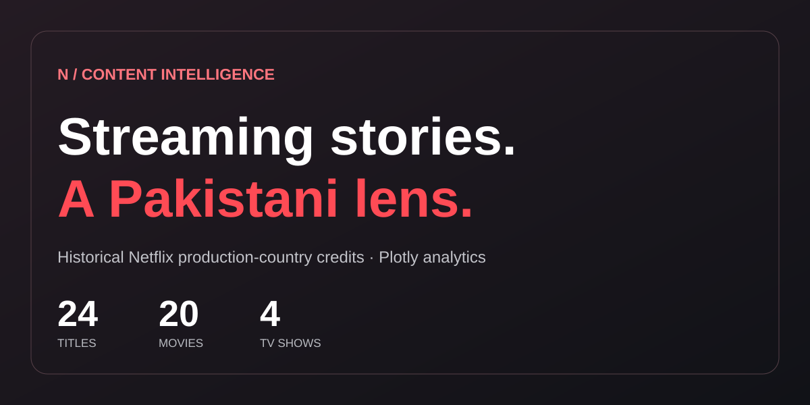

<div align="center">

# 🎬 NETFLIX PAKISTAN
### A Pakistani lens on Netflix's historical global content catalogue

**Interactive Plotly storytelling · Streamlit dashboard · EDA notebook · South Asia comparison**



[📊 Interactive static dashboard](docs/index.html) · [📓 EDA notebook](notebooks/netflix_pakistan_eda.ipynb) · [📑 Verified findings](reports/findings.md)

</div>

---

> [!IMPORTANT]
> **This is a study of Pakistan-linked production-country credits, not Netflix viewership in Pakistan.** The source is historical (last recorded addition **September 25, 2021**), not a live 2026 catalogue. The `country` metadata does not establish where a title was available or watched.

## Why this project?

Instead of another general Netflix EDA, this original project zooms into **Pakistan's credited content footprint** within the well-known Netflix Movies and TV Shows dataset, then adds South Asian context. It combines the graphical storytelling style associated with Plotly notebooks with a reusable analytics module, tested data transformations, a filterable Streamlit UI and an offline-ready static Plotly report.

**Visual inspiration:** [In-Depth Analysis of Netflix with Plotly — Kaggle](https://www.kaggle.com/code/rushikeshdane20/in-depth-analysis-of-netflix-with-plotly). This repository does **not** copy its code or claim to reproduce its exact charts.

## At a glance

| Historical source metric | Value |
|---|---:|
| All Netflix title records | **8,807** |
| Pakistan-linked title records | **24** |
| Movies / TV shows | **20 / 4** |
| Titles with international production credits | **6** |
| Distinct Netflix categories | **13** |
| India credits (for regional comparison) | **1,046** |

These counts come directly from the included CSV and are checked in automated tests.

## Two ways to explore

### 1. Zero-setup interactive dashboard (HTML)

Open [`docs/index.html`](docs/index.html) in a browser. It has **8 Plotly charts**, searchable title records and a dark, Netflix-inspired interface. The Plotly JavaScript library is bundled in the generated site, so the charts render **without an internet connection**. The HTML report is precomputed from the uploaded data.

**GitHub Pages:** In the repository Settings → Pages → Deploy from branch → `main` → `/docs` → Save. GitHub will publish the static page once the repository is uploaded. The static view is interactive at the chart level; source-wide filters are available in Streamlit.

### 2. Filterable Streamlit research app

```bash
git clone https://github.com/nazirreally/netflix-pakistan-plotly.git
cd netflix-pakistan-plotly
python -m venv .venv
# Windows: .venv\Scripts\activate
# macOS/Linux: source .venv/bin/activate
python -m pip install -r requirements.txt
streamlit run app.py
```

The Streamlit app supports format, release year, genre and rating filters, four dashboard tabs, title search, and filtered CSV download. No API key or Kaggle login is required, because a source CSV (byte-identical to the uploaded dataset) is included.

## 📓 In-depth, reproducible EDA

Run [`notebooks/netflix_pakistan_eda.ipynb`](notebooks/netflix_pakistan_eda.ipynb) in Jupyter with the repository root available. It covers:

- Dataset audit, missingness and Pakistan country-token selection
- Movie vs TV series composition and addition-year trends
- Multi-label genre counts and content classification
- Release-year patterns and addition lag
- Production-country co-credits
- Log-scale South Asia comparisons
- Source-level title verification

The dashboard, static report and notebook **share the same** `src/data.py` and `src/charts.py` transformations, preventing inconsistent definitions across outputs.

## 🧰 Tech stack

**Python** · **Pandas** · **Plotly Express/Graph Objects** · **Streamlit** · **Jupyter Notebook** · **Pytest** · **GitHub Actions** · **HTML/CSS**

## Repository map

```text
netflix-pakistan-plotly/
├── app.py                        # Filterable Streamlit dashboard
├── data/netflix_titles.csv     # Original source CSV (uncompressed)
├── src/data.py                    # Cleaning, country credits and aggregations
├── src/charts.py                  # Shared Netflix-red Plotly visual grammar
├── notebooks/netflix_pakistan_eda.ipynb
├── docs/index.html                # Standalone, static Plotly dashboard
├── docs/assets/plotly.min.js      # Bundled Plotly dependency (offline)
├── docs/assets/preview.svg        # Generated visual summary
├── scripts/build_static.py        # Rebuild the static dashboard
├── reports/findings.md            # Grounded insights and limitations
├── tests/test_data.py             # Dataset + visualization checks
├── tests/test_dashboard.py        # Streamlit AppTest render and filter checks
└── .github/workflows/tests.yml    # Automated checks
```

## Quality checks and regeneration

```bash
python -m pip install -r requirements-dev.txt
python -m pytest -q
python scripts/build_static.py
python scripts/build_static.py --verify
```

GitHub Actions runs data/chart tests, headless Streamlit AppTest smoke checks and static-site build verification. The [21 November 2026 AppTest workflow](https://github.com/nazirreally/netflix-pakistan-plotly/actions/runs/44946412932) passed. AppTest checks application execution and filter interaction; it is not a browser screenshot or visual-regression test. A separate workflow regenerates static dashboard assets when source files change.

## Analytical definitions

- **Pakistan-linked title:** the literal country token `Pakistan` appears in the comma-separated `country` field, including international co-productions.
- **Country comparison:** one title is counted once for each country credited (multi-country counts can overlap).
- **Genre:** categories from `listed_in` are multi-valued, so a title can contribute to several bars.
- **Addition year:** parsed from `date_added`, not from the title's release year; missing dates are excluded.
- **Production lag:** `added_year - release_year` in approximate calendar years; not production lead time or streaming delay in days.
- **Missing country:** excluded from country-based matches, not treated as confirmed non-Pakistani.

A source of potential bias: `country` is blank for **831** of the 8,807 records. Interpretation should remain descriptive.

## Data credit & code license

- **Dataset:** [Netflix Movies and TV Shows, Kaggle (`shivamb/netflix-shows`)](https://www.kaggle.com/datasets/shivamb/netflix-shows). This project uses the CSV supplied by the project owner; the source is packaged for reproducibility.
- **Plotly notebook inspiration:** [Rushikesh Dane's Netflix Plotly analysis](https://www.kaggle.com/code/rushikeshdane20/in-depth-analysis-of-netflix-with-plotly).
- **Code:** MIT licensed. The dataset retains its original source attribution and is not covered by the source-code license. Vendored Plotly.js is distributed under its own MIT license.
- **Trademark:** Netflix is a trademark of its owner. This is an independent educational data portfolio project, unaffiliated with Netflix.

---

<div align="center">Built by <a href="https://github.com/nazirreally">Nazir Ali Khan</a> · 2026</div>